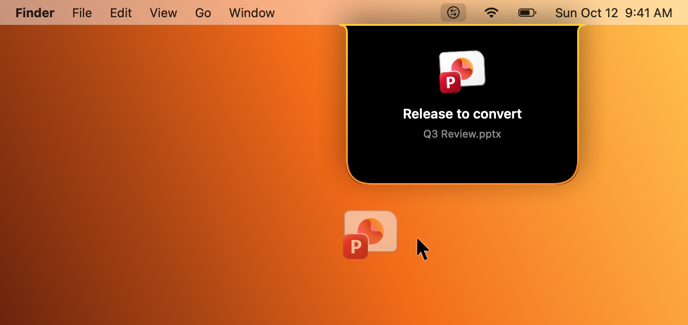
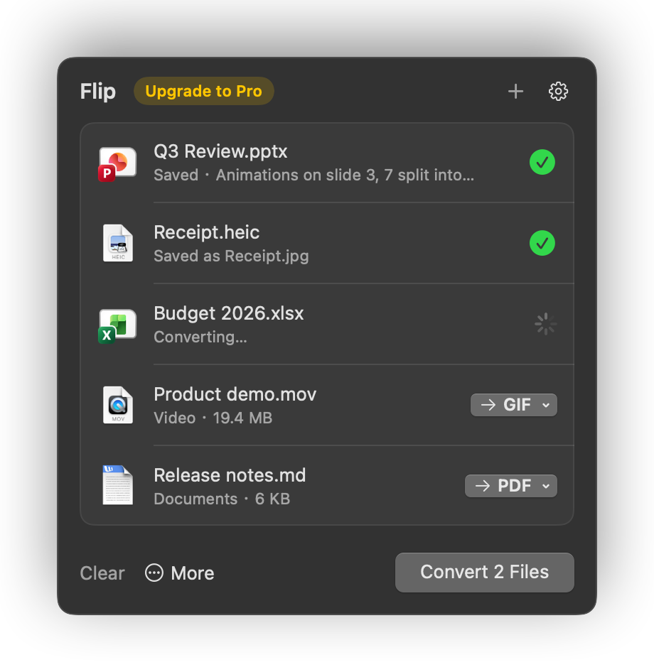
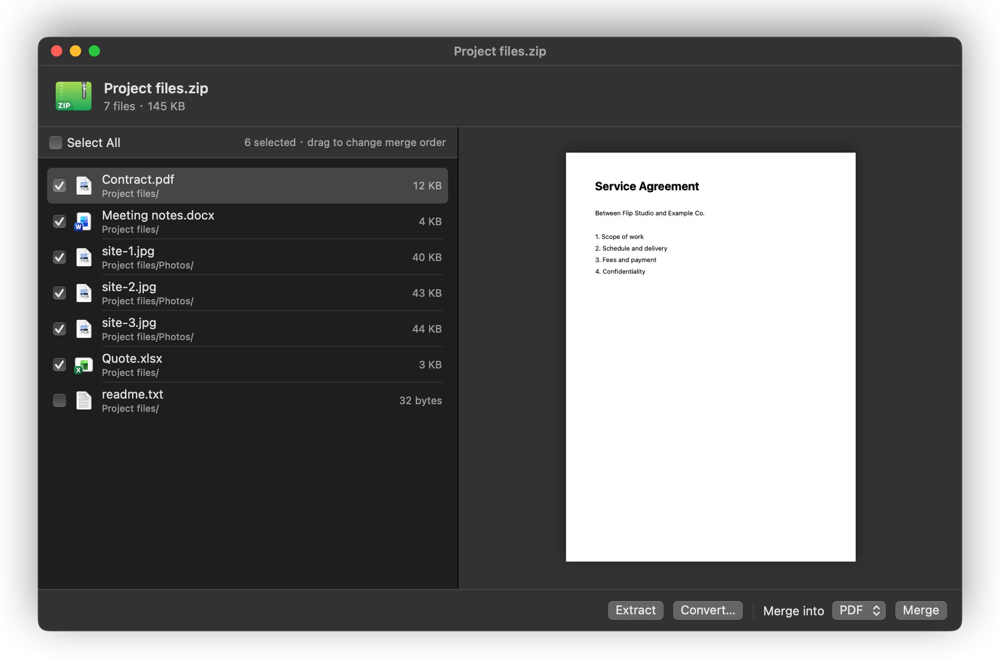
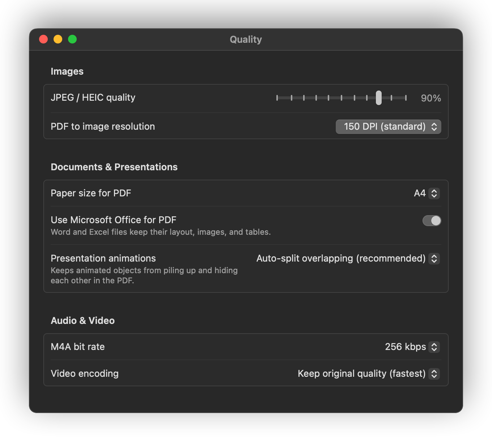

# Flip User Guide

Flip converts files from your Mac's menu bar. Everything runs on your Mac with tools built into macOS: nothing is uploaded, and there is nothing else to install.

- [Install](#install)
- [Convert files](#convert-files)
- [Archives](#archives)
- [Passwords](#passwords)
- [Merge, compress and encrypt](#merge-compress-and-encrypt)
- [PowerPoint to PDF](#powerpoint-to-pdf)
- [Animated GIFs](#animated-gifs)
- [Settings](#settings)
- [Free trial and Pro license](#free-trial-and-pro-license)
- [Updates](#updates)
- [Privacy](#privacy)
- [Troubleshooting](#troubleshooting)
- [Uninstall](#uninstall)

## Install

1. Download the latest `Flip-<version>.zip` from [Releases](https://github.com/yakiniku35/Flip-releases/releases/latest).
2. Unzip it and drag `Flip.app` into your **Applications** folder.
3. Open Flip. Its icon appears in the menu bar and in the Dock.

Flip requires macOS 14 Sonoma or later and runs on both Apple silicon and Intel Macs.

**If macOS says it can't verify Flip:** Flip is not yet notarized by Apple, so the first launch is blocked.

1. Click **Done** in the warning.
2. Open **System Settings → Privacy & Security** and scroll down to the message about Flip.
3. Click **Open Anyway**, then confirm with your password or Touch ID.

You only need to do this once.

## Convert files

There are three ways to add files:

- **Drag them to the menu bar icon.** As a file gets close, a drop zone grows out of the icon. Let go over it.
- **Drag them onto Flip's Dock icon.**
- **Click the menu bar icon, then Choose Files…**

Each file appears in the list with a suggested output format. Change the format of any file from its menu, then click **Convert**. Converted files are saved next to the originals unless you choose another folder in [Settings](#settings).

To skip the list entirely, turn on **Convert immediately when dropped on the menu bar icon** in Settings → General. Files are then converted to the default format for their type, which you set in Settings → Formats.

### Supported formats

| Kind | Drop in | Convert to |
|---|---|---|
| Images | jpg, png, heic, tiff, gif, bmp, webp, avif, ico, psd, tga | JPEG, PNG, HEIC, TIFF, GIF, BMP, PDF, and MP4/MOV for animated images |
| PDF | pdf | PNG, JPEG, DOCX, TXT |
| Documents | docx, doc, odt, rtf, html, txt, md, webarchive | PDF, DOCX, ODT, RTF, HTML, TXT |
| Spreadsheets | xlsx, xls, csv, tsv | PDF, XLSX, CSV, JSON, HTML, XLS (needs Excel) |
| Presentations | pptx, ppt, ppsx, pps, odp | PDF, PNG, JPEG, PPTX (needs PowerPoint) |
| Data | json, plist | CSV, XLSX, JSON, YAML, PLIST |
| Audio | mp3, m4a, aac, wav, aiff, caf, flac | M4A, WAV, AIFF, FLAC |
| Video | mov, mp4, m4v | MP4, MOV, GIF, M4A |
| Archives | zip, 7z, rar, tar, gz, bz2, xz, iso, cab, lzh, cpio, xar | Opens the archive browser |

Word, RTF and ODT files convert without Microsoft Office. If Office is installed, Flip uses it for Word and Excel files to keep the layout exactly as it is. You can turn this off in Settings → Quality.

## Archives

Drop an archive on Flip and a browser window opens:

- Click a file on the left to preview it on the right.
- Check the files you want, then:
  - **Extract** saves them to a new folder next to the archive, or in the folder chosen under **Save to** in Settings → General.
  - **Convert…** extracts them and adds them to the conversion list.
  - **Merge** combines them into one file. Choose the format from **Merge into**. Drag files in the list to change their order.

Extracting and compressing both show progress. Closing the window stops an extraction in progress.

## Passwords

When an archive needs a password, Flip first tries the passwords saved in Settings → Passwords. If none of them work, it asks you.

- Every password you type is saved, whether or not it worked, so you never have to type it twice. Uncheck **Remember this password (in Keychain)** to skip saving one.
- Passwords are stored in the macOS Keychain. View, edit, add or delete them in Settings → Passwords.
- Turn on **Automatically extract downloaded archives** in Settings → General, and archives that land in your Downloads folder are extracted with your saved passwords as soon as they finish downloading.

## Merge, compress and encrypt

With several files in the list, click **More**:

- **Merge into** combines them into one PDF, Excel workbook, CSV, Word document, text file, tall image, animated GIF or ZIP. The choices depend on the kinds of files in the list.
- **Compress to ZIP** puts them in one ZIP file.
- **Encrypt…** protects them with a password. Choose a method:
  - **Encrypted ZIP (AES-256)** is the most secure.
  - **Compatible ZIP** opens on Windows without extra software.
  - **PDF open password** locks PDF files themselves.
  - **Encrypted disk image (DMG)** opens only on a Mac.

## PowerPoint to PDF

A slide with several animation steps usually turns into one cluttered PDF page, with later objects covering earlier ones. Flip reads the animation order and splits only the slides whose objects actually overlap, giving one page for each click.

Choose how slides are handled in Settings → Quality → **Presentation animations**:

- **Auto-split overlapping (recommended)**
- **One page per animation step**
- **Keep only the final state of each slide**
- **Don't split (all on one page)**

Converting presentations requires Microsoft PowerPoint.

## Animated GIFs

- **Video to GIF:** drop a video and choose GIF. The GIF is scaled to 640 pixels on its longest side. Frame rate goes down for longer videos, from 15 to 5 frames per second. Videos longer than 3 minutes can't be converted.
- **GIF to video:** drop an animated GIF, WebP or APNG and choose MP4 or MOV. The original timing is kept.
- **Keep the animation:** converting an animated WebP or APNG to GIF keeps every frame. Converting an animated image to PNG, JPEG or another still format keeps only the first frame, and Flip tells you so.
- **Make an animation:** put several images in the list and use **More → Merge into → Animated GIF**. Each still image shows for 1 second.

## Settings

Open Settings from the menu bar icon (**Settings…**) or with ⌘,.

| Tab | What you can change |
|---|---|
| General | App language, open at login, show the Dock icon, where files are saved, show in Finder after converting, convert immediately on drop, automatically extract downloads, anonymous usage statistics |
| Formats | Default output format for each kind of file |
| Quality | Image quality, PDF-to-image resolution, paper size, Office conversion, presentation animations, audio bitrate, video encoding |
| Passwords | Saved archive passwords |
| Updates | Check for updates and install them |
| License | Trial status and Pro license key |

Flip is available in English, Traditional Chinese and Japanese. Change it under **App language** in Settings → General.

## Free trial and Pro license

Every feature is unlocked for 14 days from the first launch. No account is needed.

After the trial, converting, extracting and compressing keep working, up to 5 files at a time. These need a Pro license:

- Merge files
- Encrypt files
- Password vault and automatic extraction
- Splitting presentation animations
- Converting more than 5 files at once

To activate a license, open Settings → License, paste your key into **Enter License Key**, and click **Activate**. The key is checked offline, with no sign-in.

## Updates

Flip checks for new versions automatically. When one is available, go to Settings → Updates and click **Download and Install**. Flip restarts with the new version. Turn off **Check for updates automatically** if you prefer to check yourself.

## Privacy

Every conversion happens on your Mac. Flip goes online only for two things:

- **Checking for updates**, if **Check for updates automatically** is on in Settings → Updates.
- **Anonymous usage statistics**, once a day, to learn how many people use Flip. Flip sends a random ID created on your Mac, the Flip and macOS versions, whether you're on the trial or Pro, and the app language. It never sends files, file names, passwords or personal data. Turn this off with **Send anonymous usage statistics** in Settings → General.

License keys are verified offline.

## Troubleshooting

**Flip can't open a file.** Check that the file type is in the [supported formats](#supported-formats) table. Presentations need PowerPoint, and XLS output needs Excel.

**An archive asks for a password every time.** Make sure **Remember this password (in Keychain)** is checked when you enter it.

**The menu bar icon is hidden.** On a crowded menu bar, macOS may hide some icons. Quit a few menu bar apps, or drag files onto Flip's Dock icon instead.

**Flip doesn't appear in the Dock.** Turn on **Show icon in Dock** in Settings → General.

## Uninstall

1. Quit Flip from its menu bar icon.
2. Move `Flip.app` from Applications to the Trash.
3. Saved passwords and your license are stored in the Keychain. To remove them, open **Keychain Access** and delete the items named `com.yakiniku35.flip`.
