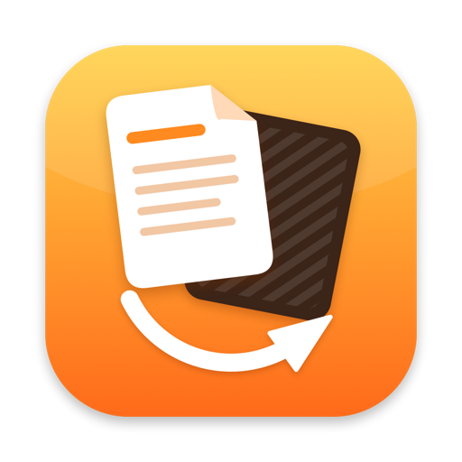

  

<h1 align="center">Flip</h1>

  A file converter that lives in your Mac's menu bar. 
  <a href="https://github.com/yakiniku35/Flip-releases/releases/latest"><b>Download</b></a> ·
  <a href="https://yakiniku35.github.io/Flip-releases/">Website</a> ·
  <a href="GUIDE.md">User Guide</a>

---

Drag a file to the menu bar icon, pick a format, and Flip converts it right on your Mac with tools built into macOS. Nothing is uploaded, and there is nothing else to install.

- **Images, documents, spreadsheets, presentations, data, audio and video**: convert between dozens of formats
- **PowerPoint to PDF** without animations piling up on one page
- **Archives**: preview what's inside, extract only what you need, or merge files into one PDF
- **Password vault**: saved passwords are tried automatically on protected archives
- **Animated GIFs**: video to GIF, GIF to video, or merge images into an animation
- **Merge, compress and encrypt** files in one click

This repository only hosts the packaged app; the source code is not public.

## Install

1. Download the latest `Flip-<version>.zip` from [Releases](https://github.com/yakiniku35/Flip-releases/releases/latest).
2. Unzip it and drag `Flip.app` into your Applications folder.

Flip requires macOS 14 or later and runs on both Apple silicon and Intel Macs. If macOS says it can't verify Flip on first launch, see [Install](GUIDE.md#install) in the guide.

Once installed, Flip finds new versions on its own under Settings → Updates.

## Learn more

Read the [User Guide](GUIDE.md) for every feature, setting and the full list of supported formats.
